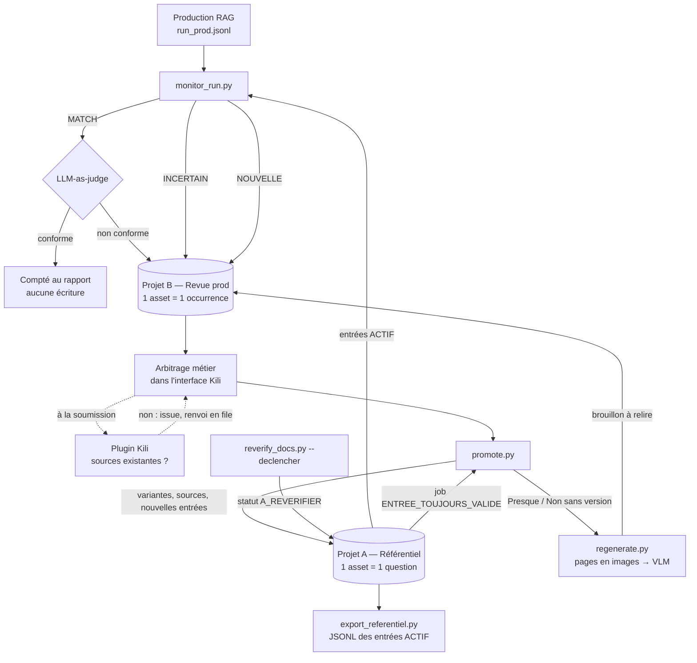

# Référentiel RAG — monitoring métier d'un RAG d'assurance

Deux projets Kili **TEXT**, pilotés par le SDK Python **épinglé à
`kili==2.142.1`**, pour tenir un référentiel de questions-réponses validées
par le métier et arbitrer, run après run, ce que produit la RAG.

La production pose des questions. Chaque question est appariée au
référentiel. Si elle y figure, la réponse générée est confrontée
automatiquement aux réponses validées ; sinon, ou si le verdict est
douteux, le cas part en revue métier et enrichit le référentiel. Une même
question porte plusieurs formulations valides, ce qui permet au
LLM-as-judge de juger plus finement.

---

## À vérifier au premier run

Rien de ce qui suit n'a pu être validé sans instance Kili : la liste est à
parcourir dans l'ordre, la première fois.

1. **Rendu rich text côté serveur.** Le format `json_content` n'est validé
   par aucune couche du SDK : il est sérialisé et téléversé tel quel. Le
   rendu dépend de la version **serveur** de l'instance, pas du SDK.
   Lancer `scripts/probe_richtext.py` **avant tout le reste** et regarder,
   sur l'asset unique qu'il importe : niveaux de titre `h1`–`h4`, marques
   (gras, italique, code, souligné), fonds de couleur, alignements,
   listes, citation, tableau. Ce qui ne s'affiche pas doit être retiré de
   `rendering.py`.
2. **Taille maximale d'un `json_metadata`.** Non documentée par Kili. Le
   projet suppose un seuil prudent de `60 000` octets
   (`MAX_METADATA_SIZE`) et bascule au-delà sur une metadata allégée
   (voir « Repli de taille » plus bas). Mesurer la vraie limite en
   important une entrée volumineuse, puis ajuster le paramètre.
3. **`update_properties_in_assets(json_contents=…)`.** À l'import,
   `append_many_to_dataset` téléverse le `json_content` dans un bucket et
   enregistre une URL. À la mise à jour, en revanche, le SDK envoie la
   **chaîne JSON telle quelle** au GraphQL (`json_contents: List[str]`).
   Vérifier que le serveur l'accepte et que la carte se rafraîchit bien
   après un `promote.py`. Si ce n'est pas le cas, il faudra supprimer puis
   réimporter l'asset.
4. **`send_back_to_queue` sur un asset déjà labellisé.** Utilisé par
   `reverify_docs.py --declencher`. Vérifier que l'asset revient bien dans
   la file `TODO` de l'annotateur **sans perdre ses labels**.
5. **Disponibilité du modèle d'embeddings.** La valeur par défaut est
   `jina-embeddings-v5-nano`. `JinaEmbeddings.check_model_available()` interroge
   `GET {URL_JINA}/models` et échoue avec un message clair si le modèle
   n'y figure pas. Le point d'entrée `/models` et l'identifiant du modèle
   n'ont pas été vérifiés contre le service réel.
6. **Signatures 2.142.1 utilisées.** Toutes ont été relues dans la roue
   installée, aucune n'a été exécutée contre une instance :
   `create_project(title, input_type, json_interface, description)`,
   `append_many_to_dataset(project_id, external_id_array,
   json_content_array, json_metadata_array)`,
   `update_properties_in_assets(project_id, external_ids, json_metadatas,
   json_contents, priorities)`, `assets(project_id, fields, metadata_where)`,
   `append_labels(project_id, asset_external_id_array, json_response_array,
   label_type)`, `send_back_to_queue`, `delete_many_from_dataset`,
   `archive_project`, `delete_project`.
7. **Filtre `metadata_where`.** La lecture des cas de revue s'appuie sur
   `metadata_where={"statut_revue": "EN_ATTENTE"}`. Le filtre est
   re-appliqué en Python après lecture ; vérifier tout de même qu'il ne
   renvoie pas une liste vide côté serveur.
8. **Piste d'audit en label `INFERENCE`.** Les variantes versées au
   référentiel sont aussi écrites comme labels `REPONSE_VALIDEE` de type
   `INFERENCE`, pour ne pas être relues comme des arbitrages humains.
   Vérifier que ces labels sont visibles dans l'interface ; sinon, s'en
   tenir à `kili.labels()` pour les consulter.
9. **URL des projets.** `demo.py` construit l'URL en retirant `/api/…` de
   l'endpoint GraphQL, puis en ajoutant `/label/projects/<id>`. À corriger
   si le chemin diffère sur l'instance.
10. **`InputType` en 2.142.1.** La liste réelle du SDK installé est
    `AUDIO, IMAGE, PDF, TEXT, TIME_SERIES, VIDEO, VIDEO_LEGACY` —
    `VIDEO_LEGACY` en plus de ce qui était annoncé. Aucun type LLM,
    aucun module `kili.llm`, aucune clé `level` : confirmé par lecture du
    paquet installé.
11. **Job à cases à cocher.** `FORMULATIONS_A_RETIRER` utilise
    `input: "checkbox"`, reconnu par le SDK
    (`services/label_data_parsing/category.py`). Vérifier que la réponse
    renvoyée est bien une liste de catégories, et que le job s'affiche
    en cases à cocher.
12. **Course sur les numéros de formulation.** Les formulations sont
    renumérotées à chaque écriture. Si `promote.py` tourne pendant qu'un
    métier a une carte ouverte, le « Réponse 2 » qu'il a sous les yeux
    peut avoir changé au moment où il enregistre. En pratique annotation
    et promotion ne sont pas concurrentes ; si elles le deviennent, il
    faudra passer à des identifiants stables et étendre les catégories du
    job au-delà de cinq.
13. **Liens vers les documents sources.** Le format rich text documenté
    n'a aucun nœud lien. La sonde importe la même URL sous trois formes
    (brute, en `code`, soulignée et colorée) et renseigne la clé `url`
    du `json_metadata` : vérifier laquelle, s'il y en a une, est
    réellement cliquable. Vérifier aussi que l'URL de la colonne
    « Lien » se replie dans sa cellule : `wordBreak` ne figure pas
    nommément dans la liste des styles documentés. Voir « Consulter le
    document source ».
14. **Police, espacements et tableau des sources.** Tranché à l'écran :
    **Kili ignore `fontSize`**, que le style soit posé sur la racine, sur
    l'élément ou sur le nœud texte, en `em` comme en `px`. Seuls les
    niveaux de titre `h1` à `h4` changent la taille du texte ; le réglage
    de police de l'interface change le texte courant, jamais les titres.
    Plus aucun `fontSize` n'est donc émis. Pour le tableau des sources,
    `width`, `border`, `padding` et `backgroundColor` sont documentés,
    mais **`minWidth` et `whiteSpace` ne le sont pas** : ce sont eux qui
    gardent les en-têtes sur une ligne et les colonnes à leur largeur
    minimale. La sonde affiche le tableau en pleine largeur et dans une
    boîte de 340 px qui simule un petit écran : si les en-têtes s'y
    coupent encore, ces deux styles sont ignorés. Vérifier aussi que les
    titres de la colonne de droite sont séparés de leur contenu.
15. **Mise en deux colonnes de la carte de revue.** La réponse à
    arbitrer est décalée à droite par les styles `margin` et `maxWidth`,
    son titre par `textAlign`. Si le serveur ignore ces styles, la
    séparation repose encore sur les couleurs de fond : rien n'est
    perdu, mais la lecture en colonnes disparaît. À constater sur la
    sonde avant de compter dessus.
16. **Catégories des `json_interface`.** Les catégories sont écrites
    `{"CODE": {"name": "Libellé", "children": []}}`, sans clé `id`. Le SDK
    ne valide pas le `json_interface` : il le sérialise et l'envoie.
    Vérifier que les deux projets s'ouvrent et que les jobs s'affichent
    comme attendu ; ajouter un `id` par catégorie si l'interface les
    exige.
17. **Modèle du juge.** `claude-sonnet-5` par défaut, via le SDK
    `anthropic`. Le prompt attend un objet JSON ; une réponse illisible
    est traitée comme « non conforme, confiance nulle », ce qui envoie le
    cas en revue plutôt que de le passer sous silence.
18. **Premier appel réel au VLM de régénération.** Aucun appel n'a pu
    être fait sans clé : le chemin complet n'a tourné qu'avec le
    rédacteur hors ligne et un client simulé. Lancer d'abord
    `regenerate.py` sur un ou deux cas. Si l'accès à l'API passe par une
    passerelle qui refuse le paramètre `fallbacks`, mettre
    `REGENERATION_FALLBACKS=false`.
19. **Pré-remplissage par un label `PREDICTION`.** Le brouillon est
    déposé dans `VERSION_CORRIGEE` par un label `PREDICTION`. Vérifier
    qu'il apparaît pré-rempli à l'ouverture de l'asset de relecture.
    Sinon, rien ne casse : « Oui » sans texte promeut le brouillon
    stocké en metadata. Le relecteur doit simplement recopier le texte
    pour le retoucher.
20. **Plugin de vérification des sources.** Ni déployé ni exécuté chez
    Kili. Vérifier dans l'ordre : que les plugins sont ouverts sur
    l'instance ; que `requirements.txt` s'installe (`pydantic` v2,
    `loguru`) ; que `catalogue` et `rag_referentiel` s'importent depuis
    la racine de l'archive ; que l'issue est visible par l'annotateur ;
    que l'asset revient dans sa file. Journaux :
    `kili.get_plugin_logs(project_id, plugin_name)`.

---

## Workflow



**Le verdict du juge n'est jamais affiché à l'annotateur.** Il reste en
metadata et sert à sélectionner les cas et à mesurer le désaccord
juge / métier. L'afficher ancrerait l'annotateur sur l'avis qu'on cherche
justement à auditer.

### Topologie

| | Projet A — « Référentiel RAG » | Projet B — « Revue prod RAG » |
| --- | --- | --- |
| Un asset | une question | une occurrence de production |
| Rôle | état de vérité | file de travail du métier |
| `external_id` | `q_<sha1(question normalisée)[:12]>` | `<question_id>__<run_id>` |
| Écrit par | `bootstrap.py`, `promote.py`, `reverify_docs.py` | `monitor_run.py`, `promote.py` |
| Annoté | à la création et lors des campagnes de revérification | en continu |

La normalisation (minuscules, sans accents, sans ponctuation, espaces
réduits) est une fonction pure et testée : `normalisation.py`.

---

## Modèle de données

Les schémas pydantic de `schemas.py` sont sérialisés dans le
`json_metadata` des assets.

### Entrée du référentiel (projet A)

```json
{
  "question_id": "q_a1b2c3d4e5f6",
  "question": "Quel est le délai de déclaration d'un sinistre auto ?",
  "statut": "ACTIF",
  "version": 3,
  "answers": [
    {"id": "a1", "text": "…", "origine": "metier",
     "auteur": "c.durand", "date": "2026-03-11", "run_id": null},
    {"id": "a2", "text": "…", "origine": "rag_valide",
     "auteur": "m.leroy", "date": "2026-05-02", "run_id": "run_42"},
    {"id": "a3", "text": "…", "origine": "rag_corrige",
     "auteur": "m.leroy", "date": "2026-07-18", "run_id": "run_57"}
  ],
  "sources": [
    {"doc_id": "cg_auto_2024.pdf", "page": 12, "doc_version": "sha1:9f3c…"}
  ],
  "derniere_verification": "2026-07-18",
  "derniere_promotion": "2026-07-18T14:02:11.000Z",
  "repli_texte": false
}
```

- `statut` ∈ `ACTIF`, `A_REVERIFIER`, `ARCHIVE`. **Seul `ACTIF` entre dans
  le scoring** ; `monitor_run.py` ne charge que ces entrées.
- `origine` ∈ `metier`, `rag_valide`, `rag_corrige`, `llm_regenere`
  (brouillon rédigé par le VLM, validé ou retouché par le métier).
- `auteur` est le **métier qui a arbitré dans le projet B**, recopié depuis
  le label ; ce n'est pas la clé d'API qui écrit dans A.
- `derniere_promotion` est le **filigrane** de la campagne du projet A :
  horodatage du dernier label déjà consommé par `promote.py`.
- Une réponse générée jugée fausse **n'entre jamais** dans `answers[]` ;
  seule y entre la formulation que le métier écrit à sa place.
- Il n'existe **aucune notion de contre-exemple** : un verdict `NON` est
  compté au rapport et n'écrit rien.

### Cas de revue (projet B)

```json
{
  "question_id": "q_a1b2c3d4e5f6",
  "run_id": "run_42",
  "motif": "DIVERGENCE",
  "question": "Sous quel délai déclarer un accident de voiture ?",
  "candidate_answer": "Vous disposez de **5 jours ouvrés**…",
  "sources": [{"doc_id": "cg_auto_2024.pdf", "page": 12,
               "doc_version": "sha1:9f3c…"}],
  "verdict_juge": {"conforme": false, "confiance": 0.31,
                   "motif": "délai divergent"},
  "score_appariement": 0.68,
  "question_id_candidat": null,
  "statut_revue": "EN_ATTENTE",
  "repli_texte": false
}
```

- `motif` ∈ `NOUVELLE_QUESTION`, `DIVERGENCE`, `APPARIEMENT_INCERTAIN`,
  `REVERIFICATION_DOC`, `RELECTURE_BROUILLON`.
- `statut_revue` ∈ `EN_ATTENTE`, `PROMU`, `REJETE`, `A_REGENERER`,
  `REGENERE`, `SOURCES_A_CORRIGER` (voir « Régénération des réponses non
  conformes »).
- Sur un asset `RELECTURE_BROUILLON`, `candidate_answer` porte le
  brouillon. S'y ajoutent `cas_origine`, `consigne_correction`,
  `reponse_rejetee` et, si la rédaction a échoué, `erreur_regeneration`.
- `question_id_candidat` n'est renseigné que pour un appariement incertain.

### Repli de taille du `json_metadata`

Toute écriture passe par `storage.py`. Si la metadata sérialisée dépasse
`MAX_METADATA_SIZE`, ou si le serveur refuse l'écriture pour cause de
volume, on bascule sur une metadata allégée :

- les textes longs sont retirés (`candidate_answer`, `answers[].text`) ;
- la question est **conservée** — c'est la clé fonctionnelle de l'entrée,
  et sa taille est bornée ;
- l'entrée est marquée `repli_texte: true` ;
- **les textes restent lisibles dans le `json_content`**, c'est-à-dire dans
  la carte affichée à l'annotateur.

Conséquence assumée : `promote.py` refuse d'ajouter une variante à une
entrée repliée, plutôt que de dédoublonner sur des textes absents. Le cas
est journalisé en `ERROR`.

---

## `json_interface` du projet A — Référentiel

| Job | Type | Requis | Rôle |
| --- | --- | --- | --- |
| `ENTREE_TOUJOURS_VALIDE` | radio `OUI` / `NON` | oui | campagne de revérification |
| `FORMULATION_CIBLE` | radio « Réponse 1 » … « Réponse 5 » | non | formulation à corriger ; vide = ajout |
| `REPONSE_VALIDEE` | transcription | non | texte de la formulation, ajoutée ou substituée |
| `FORMULATIONS_A_RETIRER` | cases à cocher « Réponse 1 » … « Réponse 5 » | non | retirer une ou plusieurs formulations |
| `SOURCES_CORRIGEES` | transcription | non | liste corrigée, qui **remplace** la liste actuelle |

- `OUI` sur `ENTREE_TOUJOURS_VALIDE` repasse l'entrée en `ACTIF` et
  actualise `derniere_verification` ; `NON` la passe en `ARCHIVE`.
- Les cinq jobs sont `CLASSIFICATION` ou `TRANSCRIPTION`, sans clé
  `level` : elle n'existe pas en 2.142.1.

### Corriger une formulation parmi plusieurs

Chaque formulation est précédée sur la carte d'un sous-titre
**« Réponse 1 »**, **« Réponse 2 »**, … — le même libellé que les
catégories des jobs, si bien que l'annotateur choisit ce qu'il lit. Le
code sous-jacent reste `a1`, `a2`, … dans la metadata :

| Ce que remplit le métier | Effet |
| --- | --- |
| `REPONSE_VALIDEE` seule | la formulation est **ajoutée**, sauf quasi-doublon |
| « Réponse 2 » + `REPONSE_VALIDEE` | `a2` est **remplacée** ; son origine repasse à `metier`, son `run_id` est effacé |
| une réponse désignée sans texte | incohérent : ignoré et journalisé |
| numéro inexistant (« Réponse 5 » sur une entrée qui en compte trois) | signalé dans `unknown_markers` du rapport, le lot continue |
| « Réponse 1 » et « Réponse 3 » cochées | les deux formulations sont retirées ; la **dernière** formulation d'une entrée n'est jamais retirable |

Un remplacement ciblé **n'est pas soumis à la règle du quasi-doublon** :
une petite correction de `a2` est un arbitrage métier explicite, pas une
variante à écarter. Si le texte corrigé devient très proche d'une autre
formulation, les deux sont conservées et un avertissement est journalisé.

Après tout retrait ou ajout, les formulations sont **renumérotées**
`a1`, `a2`, … sans trou : les numéros restent dans la plage fixée par le
plafond de variantes, et la liste de catégories du job reste donc finie
et stable.

### Corriger plusieurs formulations

Une correction par enregistrement : on désigne « Réponse 2 », on
sauvegarde, on rouvre l'asset et on désigne « Réponse 4 ». `promote.py` consomme **tous** les
labels humains créés depuis le filigrane `derniere_promotion` de
l'entrée, du plus ancien au plus récent, puis avance le filigrane. C'est
lui qui porte l'idempotence de la campagne : un label déjà consommé n'est
jamais rejoué.

Le retrait, lui, est multiple d'un coup : `FORMULATIONS_A_RETIRER` est un
job à cases à cocher.

## `json_interface` du projet B — Revue prod

| Job | Type | Requis | Rôle |
| --- | --- | --- | --- |
| `MEME_QUESTION` | radio `OUI` / `NON` | non | uniquement si `motif = APPARIEMENT_INCERTAIN` ; l'instruction le dit |
| `CANDIDATE_CORRECTE` | radio `OUI` / `PRESQUE` / `NON` | oui | verdict métier sur la réponse générée |
| `VERSION_CORRIGEE` | transcription | non | la bonne formulation, quand la réponse est `PRESQUE` **ou** `NON` ; vide, un brouillon est rédigé ; sur une relecture, pré-remplie avec le brouillon |
| `CONSIGNE_CORRECTION` | transcription | non | ce qui est faux, en une phrase, quand `VERSION_CORRIGEE` est laissée vide : le brouillon en tient compte |
| `SOURCES_PERTINENTES` | radio `OUI` / `PARTIEL` / `NON` | oui | les sources citées soutiennent-elles la réponse ? |
| `SOURCES_CORRIGEES` | transcription | non | liste corrigée, même format |

Ce que `promote.py` en fait :

| Arbitrage | Effet sur le référentiel |
| --- | --- |
| `CANDIDATE_CORRECTE = OUI` | la réponse candidate rejoint `answers[]`, `origine = rag_valide` |
| `PRESQUE` **et** `VERSION_CORRIGEE` renseignée | c'est le texte corrigé qui rejoint `answers[]`, `origine = rag_corrige` |
| `NON` **et** `VERSION_CORRIGEE` renseignée | la formulation du métier rejoint `answers[]`, `origine = metier` — elle ne doit rien à ce qu'a produit la RAG |
| `PRESQUE` ou `NON` sans `VERSION_CORRIGEE`, avec des sources de vérité terrain (`SOURCES_CORRIGEES`, ou `SOURCES_PERTINENTES = OUI`) | rien n'est encore écrit ; le cas passe en `A_REGENERER` et `regenerate.py` rédige un brouillon |
| `PRESQUE` ou `NON` sans `VERSION_CORRIGEE` ni sources de vérité terrain | rien n'est écrit, le cas passe en `REJETE` |
| relecture : `OUI` | le brouillon (ou sa version retouchée) rejoint `answers[]`, `origine = llm_regenere` |
| relecture : `PRESQUE` et brouillon retouché | le texte retouché rejoint `answers[]`, `origine = llm_regenere` |
| relecture : `NON` et texte réécrit | la formulation du métier rejoint `answers[]`, `origine = metier` |
| relecture : `PRESQUE` ou `NON` sans retouche | rien n'est écrit, `REJETE` ; un brouillon rejeté n'est jamais réécrit |
| `SOURCES_CORRIGEES` illisible ou citant un document ou une page absents (si `DOCUMENTS_DIR` est renseigné) | rien n'est appliqué ; le cas passe en `SOURCES_A_CORRIGER` et retourne dans la file du métier |
| `MEME_QUESTION = NON` sur un cas incertain | **nouvelle** entrée créée dans A |
| `MEME_QUESTION` non rempli sur un cas incertain | le cas reste `EN_ATTENTE`, rien n'est décidé à sa place |
| `SOURCES_CORRIGEES` renseignée | remplace `sources[]` (les `doc_version` connues sont reportées) ; les sources retirées sont listées au rapport |
| `SOURCES_PERTINENTES = OUI`, sans correction | les sources de l'occurrence complètent `sources[]` |

### Format des sources

Un document par élément, ses pages après le deux-points, séparées par des
espaces :

```
cg_auto_2024.pdf:12 14 31, guide_sinistres.pdf:2 7
```

donne cinq sources. Une page n'apparaît donc jamais seule et ne demande
jamais de préfixe : c'est la même écriture qu'il y ait une page ou dix.

Le tableau des sources de la carte suit la même logique : **une ligne par
document**, ses pages réunies dans la colonne « Pages ». Il occupe toute
la largeur de sa colonne — la carte entière dans le référentiel, la
colonne de la réponse générée dans la revue — avec des bordures, un
en-tête teinté et une ligne
sur deux grisée ; chaque colonne a une largeur relative et une largeur
minimale (`TABLE_COLUMNS`), pour que les en-têtes ne se coupent pas sur un
écran étroit — sous réserve que Kili respecte ces styles (point 14 de
« À vérifier au premier run »). Et **la liste courante est rappelée juste
en dessous, déjà au format de saisie** : l'annotateur la copie, modifie ce
qu'il faut, et colle le résultat dans « Sources corrigées ».

L'analyse répare les approximations de saisie plutôt que de les rejeter
(`sources.py`) :

| Saisie | Lue comme |
| --- | --- |
| `doc.pdf:p12 P14`, `doc.pdf:page 12`, `doc.pdf:p. 12` | pages 12 et 14 |
| `doc.pdf:12/14`, `doc.pdf:12+14`, `doc.pdf:12 & 14` | pages 12 et 14 |
| `doc.pdf:12-14` | pages 12, 13, 14 (intervalle plafonné à `MAX_RANGE_LENGTH`) |
| `doc.pdf:12, 14` | page 14 rattachée à `doc.pdf` — l'ancienne écriture continue de marcher |
| `«doc.pdf : 12» ; (autre.pdf:3).` | guillemets, parenthèses, espaces et point final ignorés |
| `doc.pdf:12 12, doc.pdf:12` | une seule source, les doublons sont écartés |

Ce qui reste illisible — une page seule sans document qui la précède, un
intervalle absurde, un mot à la place d'un numéro — est signalé dans
`unreadable_sources` du rapport, sans faire échouer le lot.

La saisie **remplace la liste entière** : c'est ce qui permet de corriger
plusieurs sources d'un coup, mais taper une seule ligne supprime les
autres. Les suppressions sont listées dans `removed_sources` du rapport
de promotion.

---

## Régénération des réponses non conformes

Rédiger une réponse complète coûte cher au métier, et un modèle structure
mieux une réponse longue. Sur un « Presque » ou un « Non », le métier
peut donc laisser `VERSION_CORRIGEE` vide. Il désigne les bonnes sources
(ou valide celles qui sont citées) et, s'il le souhaite, dit en une
phrase ce qui est faux (`CONSIGNE_CORRECTION`).

1. `promote.py` passe le cas en `A_REGENERER`. Les corrections de
   sources sont appliquées tout de suite.
2. `regenerate.py` rend les pages de vérité terrain en images, à partir
   des PDF de `DOCUMENTS_DIR`, et les envoie au VLM
   (`REGENERATION_MODEL`). La consigne et la réponse rejetée
   accompagnent les pages.
3. Le brouillon arrive dans le projet B sur un asset jumeau
   `<external_id>__relecture`, motif `RELECTURE_BROUILLON`, pré-rempli
   dans `VERSION_CORRIGEE`. Le cas d'origine passe en `REGENERE`.
4. Le métier relit avec les jobs habituels, puis `promote.py` verse le
   texte sous l'origine `llm_regenere`.

Un cas n'est jamais bloqué. Si les sources sont introuvables, si elles
dépassent `REGENERATION_MAX_PAGES` ou si le modèle échoue
`REGENERATION_MAX_ATTEMPTS` fois, l'asset de relecture est importé sans
brouillon et explique pourquoi. Le rapport de promotion compte les
brouillons promus (`drafts_promoted`) et ceux que le métier a retouchés
(`drafts_edited`). Un taux de retouche durablement nul signale une
validation machinale.

**Vérification des sources.** Avec `DOCUMENTS_DIR`, `promote.py` refuse
une liste de sources corrigées illisible ou qui cite un document ou une
page absents. Le cas passe en `SOURCES_A_CORRIGER` et retourne dans la
file du métier. Le plugin Kili (`plugin/main.py`, déployé par
`deploy_plugin.py`) fait la même vérification dès la soumission, avec
une issue qui dit quoi corriger. Les deux s'appuient sur la même
fonction : `source_list_problems`.

Conception, choix et limites : [REGENERATION.md](REGENERATION.md). Ce
qui reste à faire : [A_DEVELOPPER.md](A_DEVELOPPER.md).

## Appariement d'une question

`matching.py` expose le protocole `QuestionMatcher` et deux
implémentations.

- **`HybridMatcher`** (par défaut) : BM25 (`rank_bm25`) sur les questions
  normalisées, combiné à une similarité d'embeddings, par somme pondérée
  sur scores normalisés — `0.4` lexical, `0.6` sémantique. Les scores BM25,
  non bornés, sont ramenés dans `[0, 1]` en les divisant par le score que
  chaque entrée obtient **face à elle-même**.
- **`LexicalMatcher`** : BM25 seul, hors ligne, utilisé par la démo et les
  tests.

Deux seuils : au-dessus de `MATCH_THRESHOLD_HIGH` (0.72) → `MATCH` ;
entre les deux → `INCERTAIN`, le cas part en revue avec le job
`MEME_QUESTION` ; en dessous de `MATCH_THRESHOLD_LOW` (0.45) →
`NOUVELLE`.

Le backend d'embeddings est derrière le protocole `EmbeddingBackend` :
`JinaEmbeddings` (modèle configurable, disponibilité vérifiée au
démarrage) et `FakeEmbeddings` (déterministe, sans réseau, pour les
tests). Le référentiel étant petit, l'index est reconstruit en mémoire à
chaque exécution : **pas de base vectorielle**.

## Accumulation des formulations

- Une variante n'est ajoutée que si elle est **suffisamment distante** des
  formulations déjà présentes : `lexical_similarity` (indice de Jaccard
  sur les jetons normalisés, la mesure du module d'appariement) doit
  rester sous `NEAR_DUPLICATE_THRESHOLD` (0.85).
- **Plafond de 5 variantes** (`VARIANT_CAP`). Au-delà, on conserve
  les plus diverses entre elles, et **toujours** la formulation d'origine
  métier.
- Chaque variante retenue est aussi écrite comme label `REPONSE_VALIDEE`
  sur l'asset de A : la metadata porte l'état agrégé, les labels portent
  la piste d'audit horodatée.

## LLM-as-judge

Le protocole `AnswerJudge` reçoit la question, la réponse candidate et la
**liste des formulations validées** (plafonnée à `MAX_JUDGE_REFERENCES`).
Le prompt exploite explicitement cette pluralité : *la réponse est-elle
équivalente à au moins une des formulations validées, sans en contredire
aucune ?*

- `ClaudeJudge` : SDK `anthropic`, modèle `claude-sonnet-5` par défaut.
- `LexicalJudge` : recouvrement lexical normalisé au-dessus d'un seuil,
  déterministe et hors ligne, pour la démo et les tests.

Le désaccord juge / métier n'est connu qu'**après** arbitrage : il est
donc compté par `promote.py` (`judge_business_disagreements`), pas par
`monitor_run.py`.

---

## Sous-ensemble markdown couvert

La RAG produit du markdown. `markdown_to_richtext.py` convertit
markdown → HTML (`markdown-it-py`) → arbre de nœuds Kili.

| Construction markdown | Rendu Kili |
| --- | --- |
| `# … ####` | éléments `h1` à `h4` |
| `##### …`, `###### …` | repliés sur `h4` |
| paragraphe | `p` |
| `**gras**` | **marque** `bold` sur le nœud texte |
| `*italique*` | **marque** `italic` |
| `` `code` `` | **marque** `code` |
| `<u>`, `<ins>` | **marque** `underline` |
| `- …` / `1. …` | `ul` / `ol` + `li` |
| `> …` | `blockquote` (bordure gauche grise) |
| tableau GFM | `table` > `thead`/`tbody` > `tr` > `td` |
| en-tête de tableau (`th`) | `td` en gras sur fond gris — Kili ne connaît pas `th` |

Replis explicites, jamais d'exception :

| Construction | Repli |
| --- | --- |
| bloc de code ` ``` ` | une suite de `p`, chacun marqué `code`, sur fond clair |
| image | nœud texte contenant le texte alternatif, sinon `[image]` |
| lien | texte du lien conservé, URL ajoutée entre parenthèses |
| `<br>` | nœud texte contenant un saut de ligne |
| `<hr>` | paragraphe `———` |
| balise inconnue | son contenu, en texte brut, dans un `p` |
| markdown vide ou illisible | un `p` contenant le texte brut |

Les `id` de nœud texte sont générés par un compteur déterministe
(`IdGenerator`), **uniques dans tout le document** : deux rendus des
mêmes données produisent exactement le même arbre.

---

## Commandes, dans l'ordre d'un premier usage

```bash
# 0. Installation
uv sync
cp .env.example .env   # puis renseigner KILI_API_KEY

# 1. Vérifier ce que le serveur rend vraiment (5 minutes)
uv run python scripts/probe_richtext.py

# 2. Données factices
uv run python scripts/generate_sample_data.py

# 3. Démonstration complète, sans clé de modèle
uv run python scripts/demo.py --create
```

`demo.py --create` crée les deux projets, importe 12 questions validées,
apparie les 15 occurrences de production avec le matcher **hors ligne**,
et crée les cas de revue. Sortie attendue :

```
=== Démonstration prête ===
Projet A — référentiel : cl…
  https://cloud.kili-technology.com/label/projects/cl…
    12 questions déjà validées.
Projet B — revue prod  : cl…
  https://cloud.kili-technology.com/label/projects/cl…
    10 cas à arbitrer.
```

**Ce qu'il faut regarder dans l'interface Kili :**

- projet A : une carte par question, avec ses formulations validées sur
  fond vert clair sous un sous-titre « Réponse 1 », leur provenance
  (origine, auteur, date), et ses sources en tableau — **une ligne par
  document**, ses pages réunies dans la seconde colonne — suivi de la
  liste prête à copier-coller ;
- projet B : la question posée en `h1`, un encadré expliquant le motif de
  mise en revue, puis **deux colonnes** — à gauche la question du
  référentiel sur fond gris et les formulations validées sur fond vert,
  partageant le même gabarit ; à droite, tout ce qui décrit la
  prédiction : la réponse à arbitrer sur fond ambre, puis les sources
  qu'elle cite, en tableau et en liste prête à copier-coller. Les titres
  « Réponse générée à arbitrer » et « Sources citées » sont placés dans
  la colonne de droite, alignés sur son bord gauche, et séparés par un
  petit espace du contenu qu'ils annoncent.
  La question du référentiel à laquelle le cas a été apparié est
  toujours rappelée juste au-dessus des formulations qui s'y rattachent,
  même lorsqu'elle est mot pour mot celle qui a été posée. Sur une
  question inédite, il n'y a ni question de référence ni section
  « formulations validées » ;
- les libellés des jobs, en français, et le fait que `MEME_QUESTION`
  précise qu'il ne concerne que les appariements incertains ;
- **le verdict du juge n'apparaît nulle part** : il est en metadata.

Puis, le cycle courant :

```bash
# Amorcer un référentiel sur des données réelles, et créer le projet B
uv run python scripts/bootstrap.py --entree data/samples/referentiel_initial.jsonl \
    --creer-projet-revue

# Traiter un run de production (ajouter --hors-ligne pour se passer des clés)
uv run python scripts/monitor_run.py \
    --entree data/samples/run_prod.jsonl \
    --projet-referentiel <ID_A> --projet-revue <ID_B>

# Après arbitrage du métier dans le projet B
uv run python scripts/promote.py \
    --projet-referentiel <ID_A> --projet-revue <ID_B> --documents ./documents

# Rédiger les brouillons des cas passés en A_REGENERER
# (--hors-ligne : brouillon factice, sans clé ni appel au modèle)
uv run python scripts/regenerate.py \
    --projet-referentiel <ID_A> --projet-revue <ID_B> --documents ./documents

# Les deux à la suite, sans chevauchement (voir « Planifier le cycle »)
ID_A=<ID_A> ID_B=<ID_B> DOCUMENTS_DIR=./documents scripts/cycle.sh

# Plugin de vérification des sources : assembler, envoyer, activer.
# À relancer à chaque ajout ou mise à jour de document.
uv run python scripts/deploy_plugin.py --documents ./documents \
    --projet <ID_A> --projet <ID_B>

# Constater la dérive documentaire (ne modifie rien)
uv run python scripts/reverify_docs.py \
    --projet-referentiel <ID_A> --rapport --versions versions.json

# Déclencher une revérification (aucune invalidation automatique)
uv run python scripts/reverify_docs.py --projet-referentiel <ID_A> \
    --declencher --doc cg_auto_2024.pdf --pages 10-20 --dry-run

# Exporter le référentiel
uv run python scripts/export_referentiel.py --projet-referentiel <ID_A>

# Nettoyer la démonstration
uv run python scripts/demo.py --teardown --project-id <ID>
```

`versions.json` est un simple dictionnaire des versions courantes :

```json
{"cg_auto_2024.pdf": "sha1:9f3c1a2b7d40",
 "cg_habitation_2024.pdf": "sha1:41d8ec5590aa"}
```

### Planifier le cycle

`scripts/cycle.sh` enchaîne `promote.py` puis `regenerate.py`. `flock`
empêche deux cycles de se chevaucher. Aucun droit `sudo` n'est requis.
Sur un serveur Linux, la crontab de l'utilisateur suffit (`crontab -e` ;
tester d'abord `crontab -l`, qu'un `/etc/cron.allow` peut interdire) :

```cron
*/15 7-20 * * 1-5  cd /chemin/du/projet && ID_A=… ID_B=… DOCUMENTS_DIR=/chemin/documents UV=/chemin/absolu/uv scripts/cycle.sh >> logs/cycle.log 2>&1
```

Cron s'exécute avec un environnement presque vide. Il faut donc donner
le chemin absolu de `uv` (variable `UV`) et créer `logs/`. Si cron est
interdit, une boucle lancée dans `tmux` ou avec `nohup` fait l'affaire,
mais elle ne survit pas à un redémarrage :

```bash
nohup bash -c 'while true; do scripts/cycle.sh; sleep 900; done' >> logs/cycle.log 2>&1 &
```

### Variables d'environnement

| Variable | Rôle |
| --- | --- |
| `KILI_API_KEY` | obligatoire pour tout script qui parle à l'instance |
| `KILI_API_ENDPOINT` | endpoint GraphQL ; SaaS par défaut |
| `DOCUMENT_URL_TEMPLATE` | gabarit d'URL des documents sources, par exemple `https://…/Documents/{doc_id}#page={page}`. Renseigné, il ajoute une colonne « Lien » au tableau des sources et remplit la clé `url` de la metadata. Voir « Consulter le document source » plus bas. |
| `KILI_CA_BUNDLE` | chemin d'un bundle de certificats, pour une instance derrière un proxy d'entreprise. Transmis à `Kili(verify=…)`. Si le fichier n'existe pas, le script **échoue** au lieu de retomber silencieusement sur les certificats du système. La vérification TLS n'est jamais désactivée. |
| `ANTHROPIC_API_KEY` | LLM-as-judge ; inutile en `--hors-ligne` |
| `JINA_API_KEY` | embeddings ; inutile en `--hors-ligne` |
| `DOCUMENTS_DIR` | répertoire local des PDF sources ; le `doc_id` d'une source est le nom du fichier. Active la vérification d'existence des sources à la promotion, la régénération et le catalogue du plugin |
| `REGENERATION_MODEL`, `REGENERATION_EFFORT` | modèle du VLM de régénération (`claude-opus-5-5`) et effort de raisonnement (`high`) |
| `REGENERATION_DPI`, `REGENERATION_MAX_PAGES`, `REGENERATION_MAX_ATTEMPTS` | résolution du rendu des pages (150), plafond de pages par brouillon (20), tentatives avant abandon (3) |
| `REGENERATION_STYLE_FILE` | fichier texte facultatif : consignes de forme du prompt de la RAG de production, ajoutées au prompt de rédaction |
| `REGENERATION_FALLBACKS` | `true` par défaut : un refus du modèle est rejoué côté serveur sur le modèle de repli recommandé. À couper si une passerelle refuse ce paramètre |

Les seuils, plafonds et modèles sont surchargeables de la même façon
(voir `.env.example` et `src/rag_referentiel/config.py`).

### Sorties

| Fichier | Produit par | Contenu |
| --- | --- | --- |
| `reports/monitoring_<horodatage>.json` | `monitor_run.py` | volumes par décision, taux de conformité, latence, cas envoyés en revue |
| `reports/promotion_<horodatage>.json` | `promote.py` | `promoted`, `rejected`, `variants_added`, `answers_replaced`, `answers_removed`, **`judge_business_disagreements`**, `sent_to_regeneration`, `drafts_promoted`, **`drafts_edited`**, `sources_to_fix`, `unknown_markers`, `unreadable_sources`, `removed_sources`, `invalid_sources` |
| `reports/regeneration_<horodatage>.json` | `regenerate.py` | `drafts_created`, `failures` (relectures sans brouillon), `retries_pending`, et pour chaque cas l'asset de relecture et l'éventuelle erreur |
| `reports/derive_documentaire_<horodatage>.json` | `reverify_docs.py --rapport` | entrées dont une source a changé de version |
| `reports/referentiel_export.jsonl` | `export_referentiel.py` | une ligne par entrée `ACTIF`, avec toutes ses formulations et ses sources |

---

## Consulter le document source

`DOCUMENT_URL_TEMPLATE` associe un `doc_id` à son adresse — un SharePoint,
une GED, un serveur de fichiers :

```
DOCUMENT_URL_TEMPLATE=https://contoso.sharepoint.com/sites/assurance/Documents/{doc_id}#page={page}
```

Le `doc_id` est encodé pour l'URL, et l'ancre est retirée quand la page
est inconnue. Deux effets, dès que le gabarit est renseigné :

- une colonne **« Lien »** s'ajoute au tableau des sources de chaque
  carte, avec l'adresse de chaque document ;
- la clé **`url`** du `json_metadata` est remplie — c'est la seule
  affordance de lien **documentée** par le SDK Kili (« metadata visible
  on the asset with the following keys: `imageUrl`, `text`, `url` »).
  Elle ne porte qu'une adresse : elle n'est donc renseignée que lorsque
  l'asset cite un seul document, en choisir un parmi plusieurs étant
  arbitraire.

L'URL est une longue chaîne sans espace qui, sans précaution, imposerait
sa largeur à toute la colonne. Elle est donc **autorisée à se couper
n'importe où** (`wordBreak: break-all`) : elle se replie dans sa cellule
au lieu d'élargir le tableau. Elle n'est pas réduite : Kili ignore
`fontSize`.

Un nom de document accentué apparaît dans l'URL sous forme codée — `é`
devient `%C3%A9`. C'est le codage normal d'un caractère non ASCII dans
une URL, pas une corruption : le navigateur le décode et SharePoint
l'accepte. Les noms de pièces réels n'ont pas d'accent, ce qui garde
des URL lisibles.

Pour l'essayer sur la démonstration, renseigner le gabarit dans `.env`
puis lancer `demo.py --create` : les questions d'assurance habitation
citent les pièces MRH réelles — `DCON_ConditionsGénérales_MRH_202605.pdf`,
`DCON_CommentSouscrire_MRH_202605.pdf`, `DCON_DIPA_MRH_202605.pdf`.

**Réserve importante.** Le format rich text documenté n'a **aucun nœud
lien** : ni `a`, ni attribut `href`. Rien ne garantit donc qu'une URL
affichée dans le tableau soit cliquable — elle peut n'être que du texte
à copier. `probe_richtext.py` importe trois écritures d'une même URL
(brute, en `code`, soulignée et colorée) plus la clé `url` de metadata :
le premier run tranche en cinq minutes. Si rien n'est cliquable dans la
carte, la clé `url` reste le point d'entrée, et la colonne « Lien » sert
au copier-coller.

## Revérification documentaire

Les documents bougent souvent de façon mineure : **aucune invalidation
automatique**.

- `--rapport` compare les `doc_version` stockées aux versions courantes et
  **liste** les entrées concernées, sans rien modifier.
- `--declencher --doc … [--pages 10-20]` passe les entrées citant ces
  documents en `statut = A_REVERIFIER`, monte leur priorité et les remet
  dans la file (`send_back_to_queue`). Elles sortent du scoring
  automatique, mais ne sont **jamais supprimées**. Une source sans page
  reste retenue : l'intervalle de pages ne peut pas l'écarter.
- `--dry-run` affiche ce qui serait fait.
- Le retour à `ACTIF`, ou le passage à `ARCHIVE`, se fait par le job
  `ENTREE_TOUJOURS_VALIDE` du projet A, récupéré par `promote.py`.

## Cas limites traités

| Cas | Traitement |
| --- | --- |
| question vide ou tronquée | `calculer_question_id` lève ; l'occurrence est journalisée et comptée dans `ignorees` |
| markdown malformé | conversion tolérante, repli sur un `p` de texte brut |
| source sans page | `page = null` ; rendue « — » dans le tableau, retenue par la revérification |
| référentiel vide au premier run | toute question est `NOUVELLE`, score `0.0` |
| réponse candidate identique à une formulation existante | écartée comme quasi-doublon, `version` inchangée |
| deux occurrences du même run appariées à la même question | `compute_external_ids` suffixe le second `external_id` (`…__run_42_2`) |
| metadata trop volumineuse | repli documenté, textes conservés dans le rendu |
| plusieurs pages d'un même document | `doc.pdf:12 14` — les pages suivent leur document |
| approximation de saisie des sources | réparée quand c'est possible, signalée sinon (voir « Format des sources ») |
| accent décomposé dans un nom de document (copier-coller macOS) | recomposé (NFC) par le modèle `Source` : même document, même URL |
| numéro de formulation inexistant | signalé au rapport, le lot continue |
| retrait de la dernière formulation | refusé : une entrée sans réponse ne sert à rien |
| deux corrections successives sur la même entrée | les deux labels sont consommés, dans l'ordre, grâce au filigrane |

## Idempotence

`promote.py` peut être relancé sans risque : un cas de revue traité n'est
plus `EN_ATTENTE`, un label du référentiel déjà consommé est en deçà du
filigrane `derniere_promotion`, une variante déjà présente est écartée
comme quasi-doublon, `version` n'est incrémentée que si l'état change, et
la piste d'audit est écrite en label `INFERENCE` pour ne pas être relue
comme un arbitrage humain.

---

## Développement

```bash
uv run pytest          # 196 tests, entièrement hors ligne
uv run ruff check .
```

**Convention de langue.** Les identifiants Python et les docstrings sont
en **anglais** ; les noms de modules sont conservés tels quels, parce
qu'ils désignent les deux projets Kili. Tout ce qui est lu par une
personne reste en **français** : ce README, les commentaires, les
messages de log et d'erreur, les libellés et instructions des jobs Kili,
et les options de ligne de commande (`--projet-referentiel`,
`--hors-ligne`, …), reliées à un attribut anglais par le `dest`
d'argparse. Les noms de champs pydantic (`statut`, `origine`, `auteur`,
`derniere_verification`, …) ne sont pas renommés : ils forment le contrat
JSON du `json_metadata`, fixé par le cahier des charges et relu à chaque
exécution.

Les tests s'appuient sur un **faux client Kili en mémoire**
(`tests/conftest.py`) : aucun appel réseau, y compris pour les
embeddings (`FakeEmbeddings`) et le juge (`LexicalJudge`).

### Arborescence

```
src/rag_referentiel/
  config.py               pydantic-settings : seuils, plafonds, modèles
  client.py               instanciation Kili
  schemas.py              modèles pydantic de metadata
  interfaces.py           les deux json_interface
  normalisation.py        question normalisée, question_id, jetons
  richtext.py             briques du format rich text Kili
  rendering.py            composition des cartes
  markdown_to_richtext.py conversion du markdown de la RAG
  sources.py              analyse, vérification et mise en forme des sources
  matching.py             QuestionMatcher, HybridMatcher, LexicalMatcher
  embeddings.py           EmbeddingBackend, Jina, FakeEmbeddings
  judge.py                AnswerJudge, Claude et hors ligne
  labels.py               lecture des labels et metadata Kili
  storage.py              écriture avec repli de taille
  referentiel.py          projet A : lecture, écriture, promotion
  revue.py                projet B : création et lecture des cas
  documents.py            PDF sources locaux : pages, rendu en image
  regeneration.py         rédaction des brouillons par VLM
plugin/main.py            plugin Kili de vérification des sources
scripts/                  bootstrap, monitor_run, promote, regenerate,
                          reverify_docs, deploy_plugin, cycle.sh, demo,
                          probe_richtext, export_referentiel,
                          generate_sample_data
data/samples/             jeux factices (aucune donnée réelle)
tests/                    pytest, hors ligne
```
