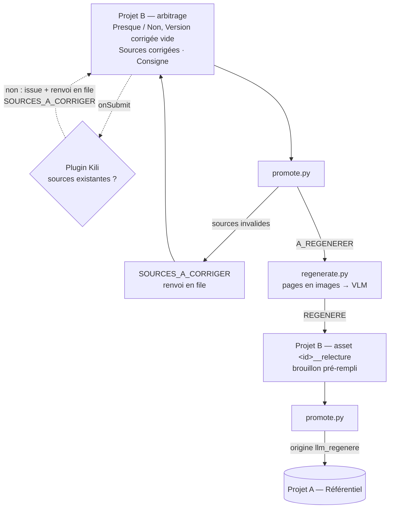

# Régénération des réponses non conformes

**En une phrase.** Quand le métier juge une réponse générée non conforme, il n'a plus à
rédiger la bonne réponse. Il désigne les bonnes sources et peut dire en une ligne ce qui
est faux. Un VLM rédige alors la réponse à partir des pages, et le métier la relit.

Ce document décrit ce qui est **implémenté** et les choix faits. Ce qui reste à faire est
listé dans [A_DEVELOPPER.md](A_DEVELOPPER.md). Les commandes sont dans le
[README](README.md).

---

## 1. Le problème

Rédiger une réponse complète coûte cher au métier, et un modèle structure mieux une
réponse longue qu'un humain pressé. Avant ces travaux, un « Non » sans version corrigée
passait en `REJETE` et n'enrichissait rien.

Le métier sait faire vite, et mieux que personne, deux choses : dire **où** est la bonne
réponse (les sources) et **ce qui** est faux. La rédaction peut lui être retirée.

---

## 2. Le workflow

### 2.1 Arbitrage, dans le projet B

| Job | Ce qui change |
| --- | --- |
| `VERSION_CORRIGEE` | Reste disponible. L'instruction dit qu'on peut la laisser vide pour obtenir un brouillon |
| `CONSIGNE_CORRECTION` | **Nouveau**, facultatif : « ce qui est faux, en une phrase » |

### 2.2 Quels cas sont régénérés

`promote.py` passe un cas en `A_REGENERER` quand les trois conditions sont réunies :

- le verdict est `PRESQUE` ou `NON` ;
- `VERSION_CORRIGEE` est vide ;
- des sources de vérité terrain sont connues :

| Arbitrage | Sources de vérité terrain |
| --- | --- |
| `SOURCES_CORRIGEES` renseignée | la liste corrigée |
| `SOURCES_PERTINENTES = OUI`, sans correction | les sources citées par la RAG |
| `PARTIEL` ou `NON`, sans correction | aucune : le cas passe en `REJETE`, comme avant |

Les corrections de sources sont appliquées au référentiel dès ce premier passage. Le
brouillon apportera le texte plus tard.

### 2.3 Rédaction : `regenerate.py`

Pour chaque cas en `A_REGENERER` :

1. les pages de vérité terrain sont rendues en PNG depuis les PDF de `DOCUMENTS_DIR`
   (`pymupdf`, `REGENERATION_DPI`). Une source sans numéro de page vaut pour tout le
   document ;
2. elles partent au VLM (`REGENERATION_MODEL`, par défaut `claude-opus-5-5`), chacune
   précédée de son repère, avec la question, la réponse rejetée et la consigne ;
3. un asset jumeau `<external_id>__relecture`, de motif `RELECTURE_BROUILLON`, est
   importé dans le projet B. Le brouillon y est pré-rempli dans `VERSION_CORRIGEE` par
   un label `PREDICTION` ;
4. le cas d'origine passe en `REGENERE`.

**Image seule, sans couche texte.** Les VLM récents lisent les tableaux complexes et les
diagrammes là où l'extraction de texte échoue, et le coût n'est pas une contrainte. Le
risque qui reste, un chiffre mal lu, est couvert par la relecture.

**Le prompt** (`REGENERATION_SYSTEM_PROMPT`) demande :

- de ne rien affirmer qui ne figure pas sur les pages ;
- de reprendre à l'identique montants, délais et conditions ;
- de **citer la page après chaque affirmation** ;
- de traiter la réponse rejetée comme un contre-exemple ;
- de faire primer la consigne de l'expert.

Les consignes de forme du prompt de production s'ajoutent si `REGENERATION_STYLE_FILE`
est renseigné.

**Repli sur refus.** Les requêtes passent le paramètre `fallbacks: "default"` (bêta
`server-side-fallback-2026-07-01`). Si le modèle refuse une requête, l'API la rejoue
côté serveur sur le modèle de repli recommandé. On le coupe avec
`REGENERATION_FALLBACKS=false`.

**Un cas n'est jamais bloqué :**

| Situation | Traitement |
| --- | --- |
| document ou page introuvable | aucun appel au modèle ; relecture **sans brouillon**, avec la raison |
| plus de `REGENERATION_MAX_PAGES` pages | même chose : rien n'est tronqué en silence |
| erreur de l'API, refus, réponse vide ou tronquée | le cas reste en `A_REGENERER`, `tentatives_regeneration + 1` ; au-delà de `REGENERATION_MAX_ATTEMPTS`, relecture sans brouillon |
| passage interrompu après la création de l'asset jumeau | terminé au passage suivant, sans doublon |

`--hors-ligne` remplace le modèle par un brouillon factice. Ça permet d'essayer tout le
circuit dans Kili sans clé.

### 2.4 Relecture : les jobs habituels

Il n'y a **pas de job dédié**. La carte de relecture pose les mêmes questions qu'une
revue : le brouillon est une réponse générée comme une autre. Pourquoi : un job
`BROUILLON_VALIDE` aurait été obligatoire sur toutes les cartes, ou inutile.
`CANDIDATE_CORRECTE` et `SOURCES_PERTINENTES`, déjà obligatoires, conviennent
exactement.

La carte montre :

- la question ;
- les formulations déjà validées, à gauche ;
- le brouillon et les sources de vérité terrain, à droite ;
- la consigne donnée au premier arbitrage ;
- en bas, en gris, la réponse rejetée.

Un brouillon qui a échoué est annoncé en tête, avec la raison de l'échec.

| Relecture | Effet |
| --- | --- |
| `OUI` | le brouillon, ou sa version retouchée, entre au référentiel, origine `llm_regenere` |
| `PRESQUE` et texte retouché | le texte retouché entre, origine `llm_regenere` |
| `NON` et texte réécrit | le texte entre, origine `metier` : il ne doit rien au brouillon |
| `PRESQUE` ou `NON` sans retouche | rien n'entre, `REJETE`. Un brouillon rejeté n'est jamais réécrit |

Le brouillon est pré-rempli dans `VERSION_CORRIGEE`. Un texte **identique** au brouillon
n'est donc pas une correction : un « Non » laissé tel quel ne promeut pas le brouillon
sous l'origine `metier`. Et si le pré-remplissage ne fonctionne pas, « Oui » sans texte
promeut quand même le brouillon conservé en metadata.

Le rapport de promotion compte `drafts_promoted` et `drafts_edited`. Un taux de retouche
durablement nul signale une validation machinale.

---

## 3. Vérification de l'existence des sources

`parse_sources` vérifie la **syntaxe** d'une liste de sources. `source_list_problems`
(dans [sources.py](src/rag_referentiel/sources.py)) vérifie en plus que chaque document
et chaque page **existent**. Elle signale aussi les fragments illisibles et propose le
nom le plus proche pour un document inconnu. Les deux lieux de contrôle appellent cette
même fonction.

### 3.1 Dans `promote.py`, le garde-fou

Si `DOCUMENTS_DIR` (ou `--documents`) est renseigné :

- **projet B** : un cas dont `SOURCES_CORRIGEES` pose problème n'est pas promu. Il passe
  en `SOURCES_A_CORRIGER` et est renvoyé une fois dans la file du métier. Les passages
  suivants le relisent, et il repart dès qu'un label valide arrive ;
- **projet A** : la correction de sources est ignorée et signalée dans
  `invalid_sources`, le reste du label est appliqué.

Si `DOCUMENTS_DIR` n'est pas renseigné, rien ne change par rapport à avant : aucune
vérification.

### 3.2 Le plugin Kili, pour le retour immédiat

[plugin/main.py](plugin/main.py) s'exécute chez Kili à chaque soumission (`on_submit`)
et à chaque revue (`on_review`). Quand une saisie pose problème, il :

1. ouvre une **issue** sur le label, qui dit quoi corriger ;
2. **renvoie l'asset** dans la file ;
3. sur le projet B, passe le cas `EN_ATTENTE` en `SOURCES_A_CORRIGER`.

Une soumission correcte remet le cas en `EN_ATTENTE`. Sur le projet A, seule l'issue est
créée.

Trois contraintes du SDK 2.142.1, relues dans la roue installée, ont dicté sa forme :

| Contrainte | Réponse |
| --- | --- |
| Le plugin tourne chez Kili, sans accès à nos fichiers | un **catalogue embarqué** `{document: nombre de pages}`, généré à partir des PDF locaux. Il ne contient que des noms de documents, déjà présents dans Kili |
| L'upload n'emporte que les `**/*.py` et `requirements.txt` | le catalogue est un **module Python** généré, `catalogue.py` |
| Le plugin agit après la soumission, sans pouvoir la bloquer | issue + renvoi en file + statut `SOURCES_A_CORRIGER`, que `promote.py` respecte |

[scripts/deploy_plugin.py](scripts/deploy_plugin.py) assemble le dossier : `main.py`,
`catalogue.py`, `rag_referentiel/sources.py` et `schemas.py`, `requirements.txt`. Il
envoie ou met à jour le plugin, puis l'active sur les projets donnés. **À relancer à
chaque ajout de document**, sinon un document récent passerait pour inconnu.
`--construire-seulement` assemble sans rien envoyer.

Le plugin sert l'ergonomie ; `promote.py` garde le référentiel. Si le plugin est absent
ou en panne, le garde-fou tient quand même.

---

## 4. Déclenchement

Par défaut, à la main, après une session d'arbitrage : `promote.py` puis
`regenerate.py`. Les deux sont idempotents.

En option, [scripts/cycle.sh](scripts/cycle.sh) enchaîne les deux sous `flock`, ce qui
empêche deux cycles de se chevaucher. On le planifie avec la crontab de l'utilisateur,
ou avec une boucle `nohup` si cron est interdit. Aucun des deux ne demande `sudo` :
voir « Planifier le cycle » dans le README. Avec un passage toutes les 15 minutes, le
métier retrouve ses brouillons pendant la même session.

Écartés pour le POC : les timers `systemd --user` (ils demandent
`loginctl enable-linger`, donc l'administrateur) et le webhook temps réel (il faut un
point d'entrée joignable depuis Kili).

---

## 5. Modèle de données

| Où | Ajout |
| --- | --- |
| `Reason` | `RELECTURE_BROUILLON` |
| `Origin` | `llm_regenere` |
| `ReviewStatus` | `A_REGENERER`, `REGENERE`, `SOURCES_A_CORRIGER` |
| `ReviewCase` | `tentatives_regeneration` (cas d'origine) ; `cas_origine`, `consigne_correction`, `reponse_rejetee`, `erreur_regeneration` (relecture) |
| `REVIEW_INTERFACE` | `CONSIGNE_CORRECTION` |
| `Settings` | `DOCUMENTS_DIR`, `REGENERATION_MODEL`, `REGENERATION_EFFORT`, `REGENERATION_DPI`, `REGENERATION_MAX_PAGES`, `REGENERATION_MAX_ATTEMPTS`, `REGENERATION_STYLE_FILE`, `REGENERATION_FALLBACKS` |

Tous les nouveaux champs ont une valeur par défaut : les metadata écrites avant ces
travaux restent lisibles.

---

## 6. Points de vigilance

- **Validation machinale.** Une relecture facile risque de devenir un réflexe. Suivre
  `drafts_edited` / `drafts_promoted` dans le temps.
- **Le juge comparerait du modèle à du modèle.** Les références `llm_regenere` sont
  écrites par un modèle, comme les réponses qu'elles servent à juger. Garder l'origine
  à part permet de mesurer cet effet.
- **La vérification des sources par l'équipe.** En fonctionnement autonome, l'existence
  des sources repose sur le plugin et `promote.py`, leur pertinence sur la relecture.
  Si la pertinence pose problème, il faudra réintroduire une étape de validation, au
  prix d'une partie de l'autonomie.
